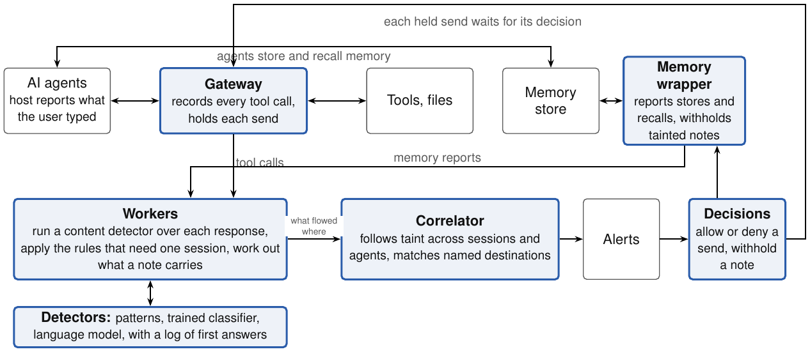

# TRACE design (as described in the paper)

This page restates Section 4 of the paper. It describes what TRACE does, not how it is coded.

(Fig. 1 of the paper; [PDF](figures/architecture.pdf).)

## Parts

- **Tool gateway.** Every tool call of the agent passes through it. It forwards each call at once, except a
  *send* (a call that sends data beyond the deployment's own domains), which it holds until every event
  that arrived before it has been judged.
- **Memory wrapper.** A small hook on the memory client. It reports each store and each recall as an ordinary
  event, one note at a time, with the text, so memory becomes one more resource that can be followed.
- **Workers.** They scan tool outputs and recalled notes and report simple facts: this session took in
  flagged content, read this resource, wrote that one, read a credential, or sent something outside.
- **Correlator.** It derives the rest with fixed rules (below), across sessions and agents, over any number
  of hops.
- **Inline gate.** It denies risky sends and withholds tainted notes at recall.

## Rules the correlator evaluates

Each step must come strictly after its cause, and within a retention window.

| Conclusion | When it holds |
|---|---|
| Session is tainted | It took in flagged content, or it read a tainted resource |
| Resource is tainted | A tainted session wrote to it |
| Injection then theft | A session sends outside after taking in flagged content |
| Taint then theft | A session sends outside after reading a tainted resource |
| Credential then theft | A tainted session reads a credential, and another session of that agent sends outside |
| Named destination | Something is sent to an outside destination that flagged content named |
| Capability chain | A session reads a credential, and another session of that agent sends outside, with no taint needed |

## Which notes pass taint on (the carry rule)

Following every output back to every earlier input makes suspicion spread until everything looks connected.
TRACE therefore passes taint through a note only if the note repeats what was flagged: a run of five words,
an outside address or an account-like value, shared with a flagged or tainted output of the same session.
Runs made only of common words (SMART stop list) and a session reading back its own note do not count. A
write whose text is not visible is assumed to carry everything. The carry rule reduces false alarms; it is
not a security boundary, because a compromised agent chooses the wording of its notes.

## Matching where the data goes

When a detector flags content, the outside destinations it names (e-mail addresses, URLs, account numbers)
are extracted, and a later send to one of them raises an alert in any session of any agent. This
destination rule needs no path between the two events.

## Recognizing injected content

A trained classifier screens all text in short overlapping windows; a local language model checks the
windows it flags, and a flag needs both to agree. A rule also flags any sentence that tells the assistant to
send something to an outside place, and such requests go to the language model. Hidden text (Unicode tag
characters, zero-width and direction characters) is made visible first, and text that hides four or more
characters is flagged.

## Holding sends and quarantining memory

A send is denied if its session took in flagged content or read a tainted note, or if it goes to a new place
that flagged content named. A named place the deployment already sends to is allowed with an alert. Before a
recall returns, tainted notes are withheld (they stay in the store). The language model can only lower a
flag and has no say over a send. Both mechanisms fail closed: a send with no verdict in time is denied, and
a recall with no verdict returns nothing.

## What is taken on trust

The host reports what the user typed, what the agent answered and whose session it was, over an
authenticated path. A send whose every destination the user named goes out even from a tainted session, with
a low-priority alert. Each user's words vouch only for that user's own sends. RQ7 of the paper tests what
happens when each of these trusted inputs is attacked.
